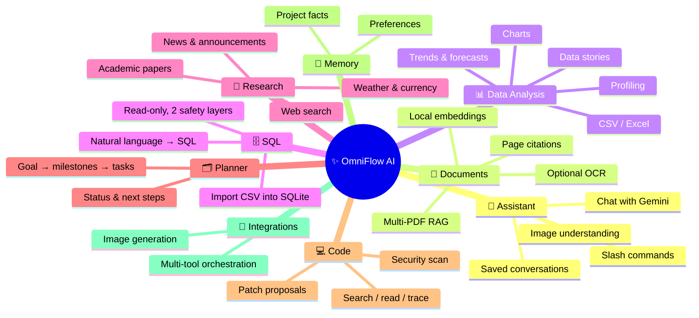
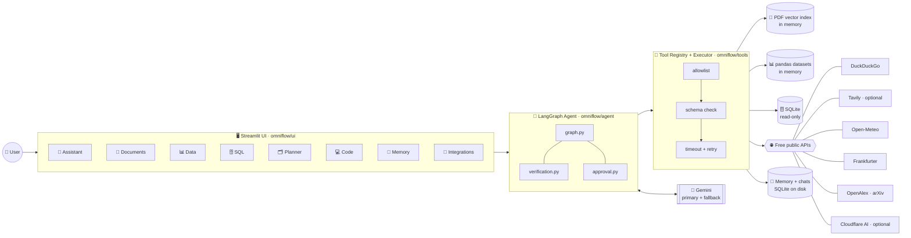
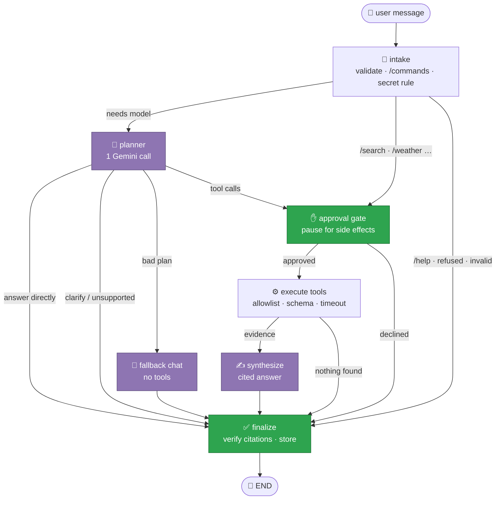
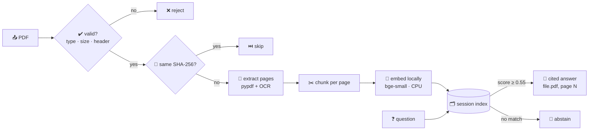
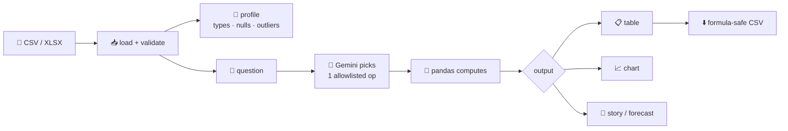
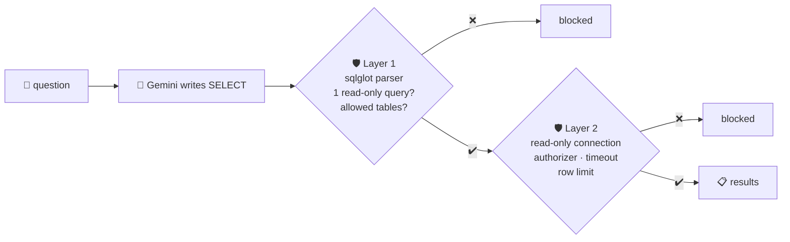
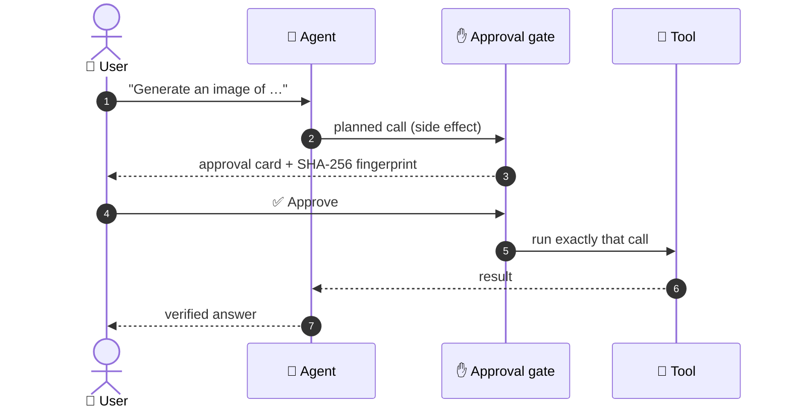
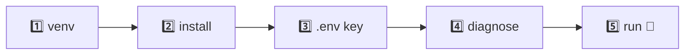

<div align="center">

# ✨ OmniFlow AI

### One AI. Every Task. Seamless Execution.


**8 workspaces · 30+ allowlisted tools · 1 LangGraph agent · 0 paid APIs**

</div>

---

## 🗺️ At a glance



---

## 🧩 System architecture



---

## 🔁 How one message flows through the agent



| 🟣 Purple = Gemini call | 🟢 Green = safety checkpoint | ♾️ Graph is **acyclic** — it cannot loop |
|:---:|:---:|:---:|

### Model calls per turn

| Request | Route | 🤖 Gemini calls |
|---|---|:---:|
| `/help`, empty, secret-request | deterministic | **0** |
| `/search` `/weather` `/news` `/papers` `/docs` | tool (planner skipped) | **1** |
| Normal question | chat | **1** |
| Needs live info | tool → synthesize | **2** |

---

## 📄 Document RAG pipeline



## 📊 Data → Insight pipeline



> 🔒 The model **never writes code** — it only chooses from a fixed menu of operations.

## 🗄️ SQL — two independent safety layers



## ✋ Human-in-the-loop approval



---

## 🧰 Tool belt

| Area | Tools | 🔑 Key needed? |
|---|---|:---:|
| 🔎 Web | `web_search` · `tavily_search` | ❌ · optional |
| 📰 Research | `news_search` · `academic_search` | ❌ |
| 🌦️ Weather | `weather_lookup` | ❌ |
| 💱 Currency | `currency_convert` | ❌ |
| 📄 Documents | `document_search` | ❌ |
| 📊 Data | `dataset_profile` · `dataset_analyze` · `dataset_chart` · `dataset_story` · `dataset_trends` · `dataset_forecast` | ❌ |
| 🗄️ SQL | `sql_schema` · `sql_query` | ❌ |
| 🗂️ Planner | `planner_propose_plan` · `planner_project_status` · `planner_next_tasks` · `planner_list_tasks` · `planner_propose_changes` | ❌ |
| 💻 Code | `code_search` · `code_read` · `code_outline` · `code_trace` · `code_security_scan` · `code_propose_patch` | ❌ |
| 🖼️ Images | `image_analyze` · `image_generate` | ❌ · optional |
| 🧠 Memory | `memory_propose` | ❌ |

> The only required key is a **free** Gemini key.

---

## 🛡️ Safety at a glance

| | Control |
|:---:|---|
| 🚫 | Model can call **only registered tools** — unknown names rejected |
| 🔢 | Per turn: **3** tool calls · **8** graph steps · recursion limit **20** |
| ⏱️ | Every tool has a **timeout**; only transient errors retried, **once** |
| 🧪 | Tool output wrapped as **untrusted evidence** (prompt-injection guard) |
| 🔗 | Fake citations, unknown links and images **stripped** before display |
| 🙅 | No evidence → agent **abstains** instead of guessing |
| 🔐 | Each browser session isolated by a **server-generated id** |
| 🗝️ | Secrets only in `.env` as `SecretStr`; **redacted** from logs |

---

## 📁 Project layout

```text
omniflow-AI/
├── app.py                  🚀 Streamlit entry point
├── omniflow/
│   ├── agent/              🧠 LangGraph graph, prompts, approval, verification
│   ├── tools/              🧰 registry, executor and every tool
│   ├── core/               ⚙️ config, LLM factory, errors, logging
│   ├── documents/          📄 PDF extraction, OCR, chunking, embeddings
│   ├── data/               📊 ingest, profile, charts, trends, forecast, story
│   ├── sql/                🗄️ database, guard, importer, sample data
│   ├── research/           🔎 news + academic sources
│   ├── planner/            🗂️ plans, tasks, changes
│   ├── code/               💻 workspace, checks, security, patches
│   ├── memory/             🧠 store, policy, retrieval
│   ├── integrations/       🔌 image generation hub
│   ├── images/             🖼️ validation + EXIF stripping
│   ├── conversations/      💾 saved chat history
│   └── ui/                 🖥️ one module per page
├── tests/                  🧪 offline pytest suite (+ opt-in live tests)
├── docs/                   📚 user guide, status, API keys
└── langgraph_*.py, streamlit_frontend*.py   🎓 original CampusX tutorial scripts
```

---

## 🚀 Quick start (Windows PowerShell)



```powershell
py -3.12 -m venv .venv                                              # 1
.\.venv\Scripts\python.exe -m pip install -r requirements-dev.txt   # 2
Copy-Item .env.example .env; notepad .env                           # 3  GEMINI_API_KEY=...
.\.venv\Scripts\python.exe -m omniflow.diagnostics --live           # 4
.\.venv\Scripts\python.exe -m streamlit run app.py                  # 5
```

## 🧪 Tests

```powershell
.\.venv\Scripts\python.exe -m pytest                                # offline · no key · no network
.\.venv\Scripts\python.exe -m ruff check omniflow tests app.py      # lint
$env:OMNIFLOW_RUN_LIVE_TESTS = "1"; .\.venv\Scripts\python.exe -m pytest -m live   # opt-in live
```

---

## 🛠️ Tech stack

| Layer | Tech |
|---|---|
| 🧠 Orchestration | LangGraph · LangChain Core · SQLite checkpoints |
| 🤖 LLM | Google Gemini (with automatic fallback model) |
| 🖥️ UI | Streamlit · Altair (Vega-Lite) |
| 📄 RAG | pypdf · fastembed (ONNX, local) · NumPy · Tesseract *(optional)* |
| 📊 Data | pandas · openpyxl · defusedxml |
| 🗄️ SQL | SQLite · sqlglot |
| 🖼️ Images | Pillow · Cloudflare Workers AI *(optional)* |
| ✅ Quality | pytest · ruff |

---

## 📚 Learn more

| 📖 Doc | What's inside |
|---|---|
| [docs/USER_GUIDE.md](docs/USER_GUIDE.md) | Step-by-step usage of every page, limits, security details, known limitations |
| [docs/STATUS.md](docs/STATUS.md) | What is verified, and how (per phase) |
| [docs/API_KEYS_AND_SERVICES.md](docs/API_KEYS_AND_SERVICES.md) | Keys, free tiers and external services |

<div align="center">

Built on the [CampusX LangGraph chatbot tutorial](https://github.com/campusx-official/chatbot-in-langgraph) · Version **0.6.0**

</div>
